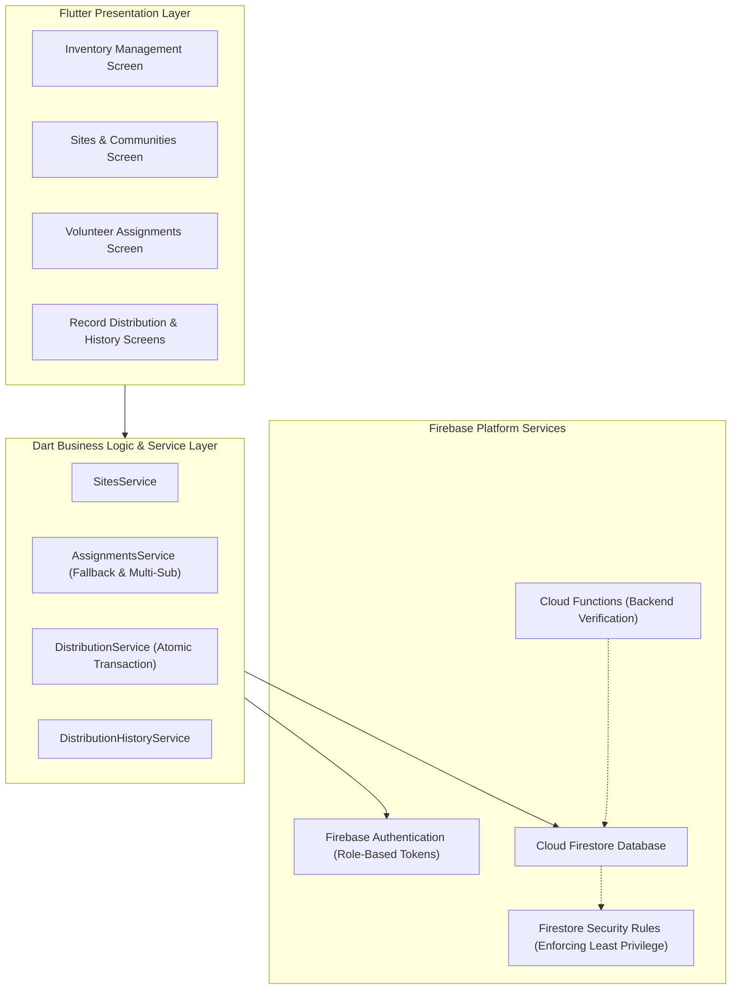
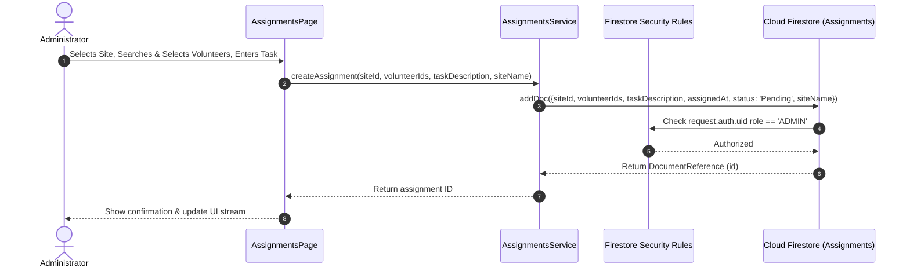
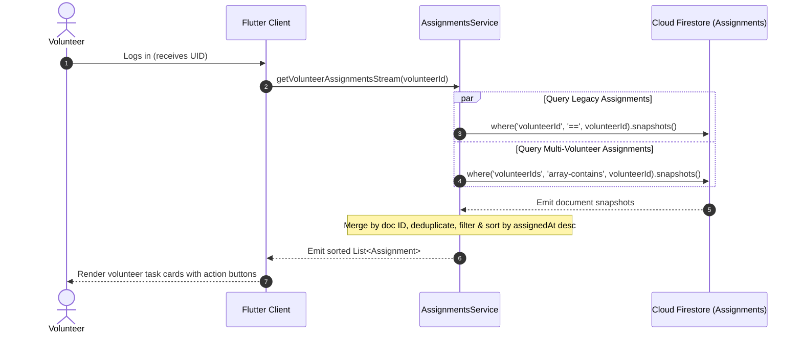
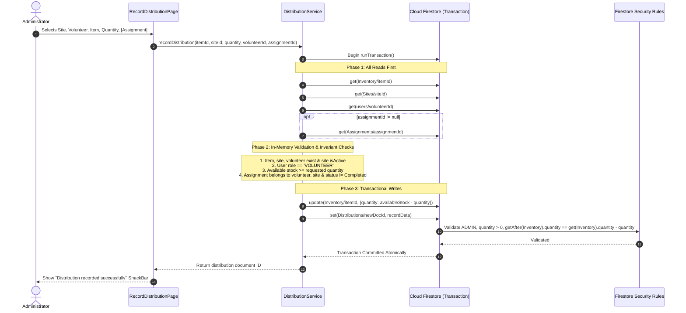

# AidGrid — High-Level Design (HLD)

## 1. Introduction

AidGrid is a Flutter application backed by Firebase services. Its architecture separates presentation, business logic, data models, authentication, and persistent storage.

The system uses Firebase Authentication for user identity and Cloud Firestore for storing operational information.

## 2. Architecture Overview

This diagram represents the logical architecture. Exact class boundaries match the production codebase across `lib/screens/`, `lib/services/`, and `lib/models/`.

## 3. Technology Stack

### Flutter
Provides the cross-platform user interface and application lifecycle.

### Dart
Implements application logic, data models, asynchronous operations, and validation.

### Firebase Authentication
Identifies authenticated users and supplies their UID for ownership and access checks.

### Cloud Firestore
Stores user profiles, inventory, sites, assignments, and distribution records.

### Firestore Security Rules
Enforces authorization at the database boundary, independently of UI visibility and client-side checks.

### Git and GitHub
Provide version control, feature branches, and collaborative source management.

## 4. Major Components

### 4.1 Presentation Layer

The presentation layer contains the screens and widgets through which users interact with AidGrid.

Responsibilities:
- Display inventory, sites, assignments, and distributions.
- Collect user input.
- Validate basic form requirements.
- Display loading indicators and errors.
- Invoke services to perform operations.

Examples of screens include:
- Assignment management.
- Volunteer assignment selection.
- Site management.
- Inventory management.
- Record Distribution.

### 4.2 Model Layer

The model layer represents domain data and converts between Dart objects and Firestore documents.

The `Assignment` model includes:
- Assignment ID.
- Site ID.
- Volunteer IDs.
- Task description.
- Assignment timestamp.
- Status.
- Optional site name.

The assignment model supports both the legacy `volunteerId` field and the newer `volunteerIds` list when parsing documents.

Other domain models represent inventory items, sites, and distribution records.

### 4.3 Service Layer

Services encapsulate business operations and Firestore interactions.

**AssignmentService**
- Retrieves assignments.
- Creates assignments.
- Supports volunteer-specific assignment streams.
- Updates assignment status.
- Maintains compatibility with legacy assignment records.

**DistributionService**
- Validates distribution inputs.
- Retrieves relevant Firestore documents.
- Validates the selected item, site, volunteer, and optional assignment.
- Updates inventory and creates a distribution record inside a transaction.

Inventory and site operations are handled by their corresponding application services or data-access logic.

### 4.4 Firebase Layer

Firebase provides authentication, persistence, real-time updates, and database authorization.

Firestore streams allow relevant screens to react to database changes. Transactions ensure that related distribution writes succeed or fail together.

## 5. Data Architecture

The application uses the following Firestore collections:

| Collection | Purpose |
|---|---|
| `users` | User profiles and role information |
| `Inventory` | Items and available quantities |
| `Sites` | Distribution-site information |
| `Assignments` | Tasks, assigned volunteers, sites, and statuses |
| `Distributions` | Records of distribution operations |

Collection names are case-sensitive and must match the names used in the application.

### Assignment relationships

An assignment references:
- A site through `siteId`.
- One or more volunteers through `volunteerIds`.

Older documents may reference one volunteer using `volunteerId`.

### Distribution relationships

A distribution references:
- An inventory item through `itemId`.
- A site through `siteId`.
- A volunteer through `volunteerId`.
- An optional assignment through `assignmentId`.

These are document references represented by IDs; they do not imply relational database foreign-key enforcement.

## 6. Key Data Flows

### 6.1 Assignment Creation Workflow

### 6.2 Volunteer Assignment Retrieval Workflow

The retrieval implementation supports both the legacy single-volunteer query and the new array-membership query. Firestore security rules must also permit every document the query could return.

### 6.3 Distribution Recording & Transaction Workflow

If the transaction fails (e.g. stock depletion or connection abort), Firestore rolls back all writes automatically; neither the inventory deduction nor the distribution record is committed alone.

## 7. Authorization Architecture

The current Firestore rules distinguish between administrators and authenticated users.

### Users
Users can read their own profiles and administrators can read user profiles. Ordinary profile updates must preserve the existing role.

### Inventory
Authenticated users can read inventory. Only administrators can create, update, or delete inventory documents.

### Sites
Authenticated users can read sites. Only administrators can create, update, or delete sites.

### Assignments
Administrators can manage assignments. Assigned volunteers can read their assignments and update only the status field, subject to the security rules.

### Distributions
Distribution creation is restricted to administrators. Updates and deletes are disabled. Reads are permitted to administrators and, where the stored record matches the rule, the recorded volunteer.

## 8. Reliability and Consistency

The architecture uses:
- Firestore transactions for inventory deduction and distribution creation.
- Stream subscriptions for live assignment updates.
- Validation before writing data.
- Error handling for failed database operations.
- Firestore Security Rules as the authoritative authorization layer.

Client-side validation improves usability but does not replace server-enforced rules.

## 9. Architectural Trade-offs

### Firebase versus a custom backend
Firebase reduces infrastructure and backend deployment requirements. The trade-off is that business constraints and authorization must be expressed carefully in security rules and client transactions.

### Real-time streams versus one-time reads
Streams provide timely UI updates. The trade-off is subscription lifecycle management and additional read activity.

### Transactional distribution writes
Transactions preserve consistency between inventory and distribution records. The trade-off is that all reads and writes must follow Firestore transaction constraints, and failed transactions may be retried.

### Legacy assignment compatibility
Supporting old and new assignment formats avoids requiring an immediate data migration. The trade-off is maintaining two query paths and ensuring both are represented in authorization rules.

## 10. Security and Deployment Considerations

- Keep privileged configuration and credentials out of public source control.
- Configure Firebase Authentication for supported platforms.
- Test Firestore Security Rules before publishing changes.
- Verify admin and volunteer behavior with separate accounts.
- Confirm that Firestore queries comply with the security rules.
- Treat client-side role checks as a UI convenience, not an authorization boundary.
