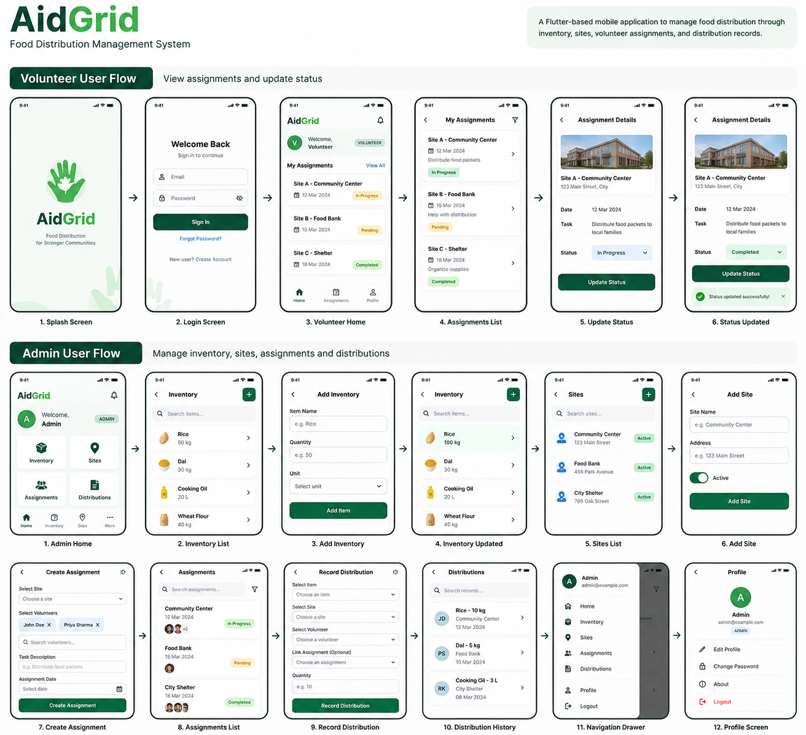

# AidGrid — Food Distribution Management System

AidGrid is a Flutter-based food distribution management application designed to help nonprofit organizations coordinate inventory, distribution sites, volunteers, and assignments. It centralizes operational data and uses role-based access to support food distribution activities across multiple communities.

## Features

- **Inventory Management:** View and manage inventory items and stock quantities.
- **Site Management:** Maintain information about distribution sites.
- **Volunteer Management:** Retrieve registered volunteers and assign them to distribution tasks.
- **Assignment Management:** Create assignments for one or more volunteers and track their progress.
- **Distribution Tracking:** Record distributions with item, quantity, site, and volunteer information.
- **Role-Based Access Control:** Distinguish between administrators and volunteers using Firebase Authentication and Firestore Security Rules.
- **Firestore Data Updates:** Use Firestore streams to reflect changes in relevant application data.
- **Volunteer Search:** Search for volunteers when creating assignments.
- **Legacy Assignment Compatibility:** Support both older assignments using `volunteerId` and newer assignments using `volunteerIds`.

## Problem Statement

Nonprofit organizations often coordinate food distribution across multiple communities through fragmented communication channels. This can make it difficult to monitor available stock, coordinate volunteers, and maintain reliable distribution records.

AidGrid aims to centralize these activities in one application, helping coordinators organize assignments, track inventory, and record distributions.

## Tech Stack

| Component            | Technology              |
| -------------------- | ----------------------- |
| Frontend and UI      | Flutter                 |
| Programming language | Dart                    |
| Backend services     | Firebase                |
| Database             | Cloud Firestore         |
| Authentication       | Firebase Authentication |
| Version control      | Git and GitHub          |

## User Roles

### Administrator

Administrators have management access to operational data.

- Create, update, and delete inventory items.
- Manage distribution sites.
- Create, update, and delete assignments.
- Record food distributions.
- Access administrative data according to Firestore Security Rules.

### Volunteer

Volunteers have restricted access based on their assigned responsibilities.

- View assignments they are assigned to.
- Update permitted assignment status fields.
- Access application data allowed by their role and the database security rules.

## Assignment Workflow

1. An administrator creates an assignment and associates it with a distribution site.
2. One or more volunteers are assigned to the task.
3. Assigned volunteers view their tasks.
4. Volunteers update assignment status as work progresses, subject to the application's permissions.
5. A distribution can optionally be associated with an assignment.

Supported assignment statuses:

- `Pending`
- `In Progress`
- `Completed`

### Assignment Data Compatibility

AidGrid supports two assignment formats:

- **Legacy format:** `volunteerId` stores a single volunteer ID.
- **Multi-volunteer format:** `volunteerIds` stores a list of volunteer IDs.

The assignment retrieval logic combines results from both formats and deduplicates assignments by document ID.

## Distribution Workflow

1. Select a distribution site.
2. Select a volunteer.
3. Select an inventory item.
4. Optionally link an assignment.
5. Enter the quantity to distribute.
6. Submit the distribution record.

The distribution service uses a Firestore transaction to coordinate the inventory update and distribution record creation. This is intended to prevent partial updates when an operation fails.

Distribution creation is restricted to administrators by the current Firestore Security Rules.

## Database Structure

AidGrid uses the following Cloud Firestore collections:

| Collection      | Purpose                                       |
| --------------- | --------------------------------------------- |
| `users`         | User profiles and role information            |
| `Inventory`     | Inventory items and available quantities      |
| `Sites`         | Distribution site information                 |
| `Assignments`   | Assignment details, volunteer IDs, and status |
| `Distributions` | Records of food distribution operations       |

Collection names are case-sensitive. The names above reflect the current application structure.

## Security

Firestore Security Rules enforce access permissions at the database level.

The current rules are designed to enforce the following restrictions:

- Users cannot change their own role through ordinary profile updates.
- Inventory creation, updates, and deletion are restricted to administrators.
- Site creation, updates, and deletion are restricted to administrators.
- Assignment creation and deletion are restricted to administrators.
- Assigned volunteers can update permitted assignment status fields.
- Distribution creation is restricted to administrators.
- Distribution updates and deletions are disabled.

Client-side checks improve the user experience, but they are not a substitute for database-enforced permissions.

These rules should be verified with separate administrator and volunteer accounts before the application is considered security-tested.

## Getting Started

### Prerequisites

Install the following:

- Flutter SDK
- Dart SDK compatible with the installed Flutter version
- Git
- An editor such as Visual Studio Code or Android Studio
- A Firebase project with Authentication and Cloud Firestore configured

### 1. Clone the repository

```bash
git clone <YOUR_REPOSITORY_URL>
cd <YOUR_PROJECT_DIRECTORY>
```

Replace the placeholders with your actual Git repository URL and project directory.

### 2. Install dependencies

From the project root, run:

```bash
flutter pub get
```

### 3. Configure Firebase

Configure the application to connect to your Firebase project.

If the project uses FlutterFire CLI, run:

```bash
dart pub global activate flutterfire_cli
flutterfire configure
```

Follow the prompts to select your Firebase project and configure the required platforms.

Also verify that:

- Firebase Authentication is enabled with the sign-in methods used by the application.
- Cloud Firestore has been created and configured.
- The required Firestore collections and document fields are available.
- The intended Firestore Security Rules have been published.
- The Firebase configuration files required by your selected platforms are present.

Firebase client configuration does not automatically create your database schema or publish your security rules. Configure these separately as required by the project.

**Security note:** Never commit service-account private keys, passwords, or other secrets to the repository.

### 4. Run the application

For a connected device or emulator:

```bash
flutter run
```

For Chrome, if web support is configured:

```bash
flutter run -d chrome
```

## Testing and Code Analysis

Run static analysis:

```bash
flutter analyze
```

Run the Flutter test suite:

```bash
flutter test
```

Static analysis checks for many code issues, while automated and manual tests are needed to verify runtime behavior and access permissions.

Manual testing should cover:

- Legacy and multi-volunteer assignment retrieval.
- Assignment status filtering and updates.
- Administrator and volunteer access restrictions.
- Inventory quantity updates.
- Successful and invalid distribution operations.
- Firestore Security Rules.
- Error handling and local fallback behavior.

Record actual test results before reporting the application as fully tested.

## Future Improvements

Potential improvements include:

- Inventory and distribution reports.
- Low-stock alerts.
- More detailed assignment and distribution dashboards.
- Improved filtering and search.
- Automated tests for Firestore Security Rules.
- More robust offline handling and synchronization.
- Migration tools for legacy assignment documents.

## License

No license has been specified yet. Add an appropriate license before publicly distributing the project or granting others reuse rights.

## UI/UX Mockup

The following image illustrates a proposed AidGrid user interface. It is a design mockup, not necessarily a screenshot of the running application.


